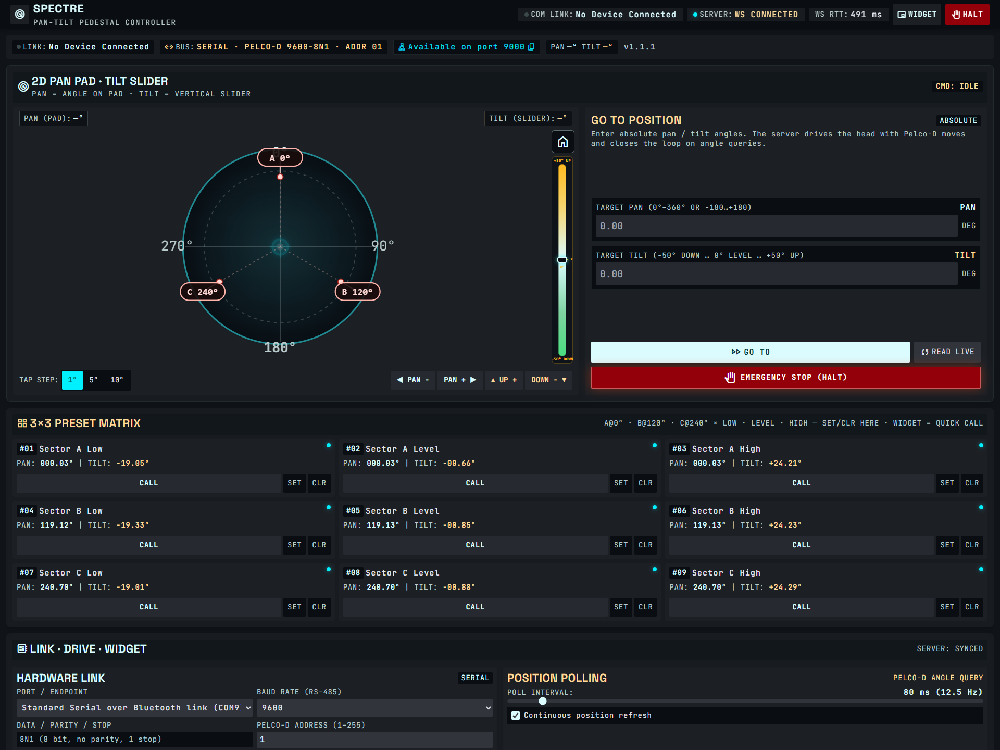
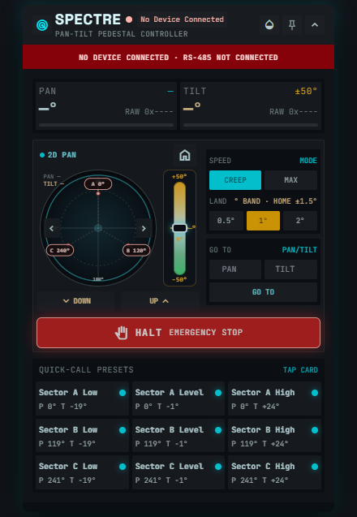

# SPECTRE

Local Pelco-D pan/tilt controller — web console on `127.0.0.1:9000`, optional always-on-top desktop widget, closed-loop landing, sector presets, and halt.

[](https://github.com/bassit-ali/Spectre/releases/latest)
[](LICENSE)

**v1.1.2** · [Downloads](https://github.com/bassit-ali/Spectre/releases/tag/v1.1.2) · Console: http://127.0.0.1:9000/ · Widget: http://127.0.0.1:9000/widget.html





Full-page console shot: [docs/screenshots/console-full.png](docs/screenshots/console-full.png)

---

## Install

Prefer the release packages — you should not need a daily `npm` workflow just to run SPECTRE.

| File | Platform |
|------|----------|
| **SPECTRE-Setup.exe** | Windows x64 (recommended) |
| `SPECTRE-windows-x64-v1.1.2.zip` | Windows portable + `install.ps1` |
| `spectre-linux-x64.tar.gz` | Linux x86_64 |
| `spectre-linux-arm64.tar.gz` | Linux ARM64 / Pi |
| `SPECTRE-Install-Guide.pdf` | Printable guide |

Field steps: [docs/INSTALL.md](docs/INSTALL.md). Release notes: [docs/RELEASE.md](docs/RELEASE.md).

### Windows

1. Install [Node.js LTS](https://nodejs.org/) if it is not already on `PATH`.
2. Run **SPECTRE-Setup.exe** as Administrator.
3. Open http://127.0.0.1:9000/ after install (or after logon — the service starts with your user session).

Setup copies into `C:\Program Files\SPECTRE\`, registers logon autostart, and stages the Electron overlay. The binary is unsigned; on SmartScreen use *More info → Run anyway* for builds you trust.

Portable path:

```powershell
Expand-Archive SPECTRE-windows-x64-v1.1.2.zip -DestinationPath C:\Temp\spectre
cd C:\Temp\spectre
.\install.ps1   # elevated
```

Uninstall: Apps → SPECTRE, or `.\installers\windows\uninstall-system.ps1` (elevated).

### Linux / Pi

```bash
tar -xzf spectre-linux-x64.tar.gz   # or spectre-linux-arm64.tar.gz
cd spectre
sudo ./install.sh
```

That installs under `/opt/spectre`, enables `spectre.service`, and sets USB-serial udev / `dialout` when it can. On a cross-built ARM image, rebuild natives once:

```bash
cd /opt/spectre && npm rebuild serialport
sudo systemctl restart spectre
```

---

## First run

1. Confirm the header shows the server connected.
2. Plug the USB-serial adapter → **Ports** → pick COM / `/dev/ttyUSB*`, **9600**, address **1** → **Connect**.
3. Hit **HALT** once before you jog.
4. Optional: **RUN SELF-TEST**.

RS-485 is the default link. Ethernet UDP is optional in **Hardware Link** (same Pelco-D commands; different wire). Leave “prefer UDP” off unless you want boot auto-connect to try LAN first.

---

## What you get

- **2D pan pad** and **vertical tilt rail** (−50°…+50°)
- Absolute **GO TO** with encoder landing (0.5° / 1° / 2° band)
- **Home** settle ±1.5°
- **3×3 sector presets** (A/B/C × Low / Level / High)
- Console + widget **HALT**
- Widget still opens when the bus is down (offline banner)
- Windows logon autostart; Linux **systemd**

Config lives under `C:\ProgramData\SpectrePT\config.json` on Windows (Linux path is logged at boot).

---

## Develop from source

Only needed when changing the code. If a system install already owns port 9000, uninstall it first.

```bash
npm install
npm --prefix web install
npm --prefix pip-shell install
npm run build
npm run server:start
# optional overlay:
npm run pip:start
```

UI watch: `npm run web:dev` · server watch: `npm run dev:server`

### Tests

```bash
npm run test:ux          # no hardware
npm run test:transport   # RS-485 vs UDP command parity
npm run test:regression  # needs live serial + encoders
```

### Rebuild packages

```powershell
npm run pack:win
npm run pack:linux
npm run pack:docs
```

Artifacts land in `release/` (gitignored). Attach them to a GitHub Release; do not commit the binaries.

---

## Layout

```
server/      Fastify + serial + motion
web/         console + widget (Vite)
pip-shell/   Electron always-on-top shell
installers/  Windows NSIS, Linux tar + install.sh, guide PDF
scripts/     ship gates; scripts/lab/ for hardware probes
docs/        INSTALL.md, RELEASE.md, screenshots/
```

---

## Troubleshooting

| Problem | What to try |
|---------|-------------|
| Port 9000 busy | Uninstall system SPECTRE or stop the other Node process |
| No link | Wrong COM, missing driver, address ≠ 1, head powered off |
| Widget missing | Confirm Electron staged; Windows needs a logged-on session |
| Linux serial denied | User in `dialout`, replug, `systemctl restart spectre` |
| Native module mismatch | `npm rebuild serialport` on the target machine |

```bash
curl http://127.0.0.1:9000/health
```

---

MIT — see [LICENSE](LICENSE).
