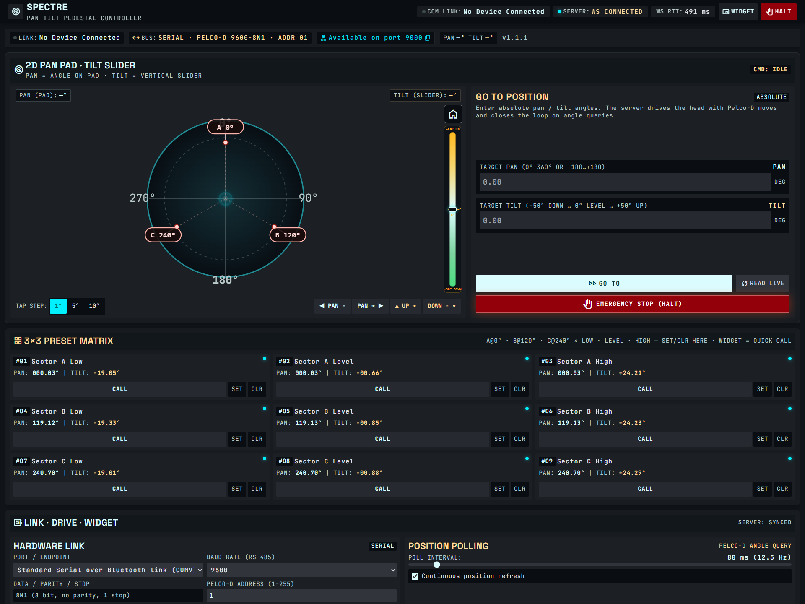
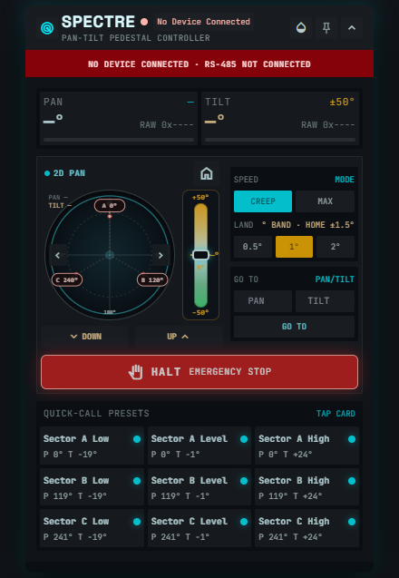

# SPECTRE — Install Guide

**Version 1.1.2**

SPECTRE is a local pan/tilt controller for Pelco-D heads. It binds to **127.0.0.1:9000**, serves the web console, and optionally shows an always-on-top desktop widget.

| | |
|---|---|
| **Console** | http://127.0.0.1:9000/ |
| **Widget** | http://127.0.0.1:9000/widget.html |
| **WebSocket** | `ws://127.0.0.1:9000/ws` |





---

## Ship artifacts (latest only)

| File | Platform | Role |
|------|----------|------|
| `SPECTRE-Setup.exe` | Windows x64 | **Recommended** all-users installer |
| `SPECTRE-windows-x64-v1.1.2.zip` | Windows x64 | Portable payload + `install.ps1` |
| `spectre-linux-x64.tar.gz` | Linux x86_64 | Extract + `sudo ./install.sh` |
| `spectre-linux-arm64.tar.gz` | Linux ARM64 / Pi | Same |
| `SPECTRE-Install-Guide.pdf` | All | This guide (printable) |

Install from these packages for day-to-day use. Building from source is only for developers.

---

## Requirements

### All platforms

- **Node.js LTS** on `PATH` (Node 20+ preferred)
- USB-serial driver for your adapter (CH340 / FTDI / etc.)
- Pelco-D pan/tilt with angle query support for closed-loop landing

### Windows

- Windows 10/11 x64
- Administrator rights for Setup.exe / `install.ps1`

### Linux

- x86_64 or aarch64 (Raspberry Pi 4/5)
- `sudo` + `systemd`
- User in `dialout` for serial
- Desktop `DISPLAY` for the Electron overlay (otherwise use the browser widget)

---

## Windows install

### Recommended: Setup.exe

1. Install **Node.js LTS** if it is not already on `PATH`.
2. Run **`SPECTRE-Setup.exe` as Administrator**.
3. After install / logon, open **http://127.0.0.1:9000/**.
4. The desktop widget starts with the service when a user session is active.

What the installer does:

- Copies the app to `C:\Program Files\SPECTRE\`
- Installs production `node_modules` (including `serialport`)
- Stages **pip-shell** with Electron for the overlay
- Creates Start Menu shortcuts
- Registers HKLM logon Run so the overlay can draw on the desktop
- Writes uninstall metadata under Programs and Features

> **SmartScreen:** the Setup binary is **unsigned**. On trusted builds choose *More info → Run anyway*.

### Portable ZIP

```powershell
# Elevated PowerShell
Expand-Archive SPECTRE-windows-x64-v1.1.2.zip -DestinationPath C:\Temp\spectre-payload
cd C:\Temp\spectre-payload
.\install.ps1
```

### Uninstall (Windows)

```powershell
# Elevated
.\installers\windows\uninstall-system.ps1
```

Or use **Apps → SPECTRE → Uninstall**.

---

## Linux / Raspberry Pi install

| Machine | Archive |
|---------|---------|
| Intel/AMD 64-bit PC | `spectre-linux-x64.tar.gz` |
| Raspberry Pi / ARM64 | `spectre-linux-arm64.tar.gz` |

Check with `uname -m` → `x86_64` or `aarch64`.

```bash
tar -xzf spectre-linux-x64.tar.gz   # or spectre-linux-arm64.tar.gz
cd spectre
sudo ./install.sh
```

Open **http://127.0.0.1:9000/**.

The installer:

- Installs to `/opt/spectre`
- Enables `spectre.service` (starts on boot)
- Starts the service immediately
- Writes USB-serial udev rules and adds the installing user to `dialout` when possible
- Installs Electron for `pip-shell/` when npm is available

### Raspberry Pi notes

1. Prefer the **arm64** archive on 64-bit Raspberry Pi OS.
2. Install Node.js LTS first.
3. If serial fails after first install:

```bash
cd /opt/spectre
npm rebuild serialport
sudo systemctl restart spectre.service
groups   # confirm dialout; re-login if just added
```

Typical USB-RS485 device: `/dev/ttyUSB0` (select it in the console port list).

### Cross-built archives

If the archive was built on a different CPU than the target (common when packaging on Windows):

```bash
cd /opt/spectre
npm rebuild serialport
sudo systemctl restart spectre.service
```

### Service control

```bash
sudo systemctl status spectre.service
sudo systemctl restart spectre.service
sudo systemctl stop spectre.service
journalctl -u spectre.service -f
```

### Uninstall (Linux)

```bash
sudo systemctl disable --now spectre.service
sudo rm -f /etc/systemd/system/spectre.service
sudo systemctl daemon-reload
sudo rm -rf /opt/spectre
```

---

## First run — connect the head

1. Open **http://127.0.0.1:9000/** — header should show **SERVER: WS ONLINE**.
2. Plug the USB-serial adapter; refresh **Ports** in Hardware Link.
3. Select the port (e.g. `COM13` / `/dev/ttyUSB0`), baud **9600**, address **1**.
4. Click **Connect**. Ribbon should show link **ONLINE**.
5. Optional: **RUN SELF-TEST** to verify serial + encoder replies.
6. Use **HALT** before unplugging serial or powering the head down mid-move.

Soft tilt limits are **−50° … +50°**. Home settles within **±1.5°**.

---

## Safety

- Prefer **HALT** before reconnecting or power-cycling the pedestal.
- Soft limits are software only — not a substitute for mechanical stops.
- Service binds to **localhost** by default; do not expose `:9000` to untrusted networks.
- Moving heads can injure people and equipment — keep the sweep clear.

---
